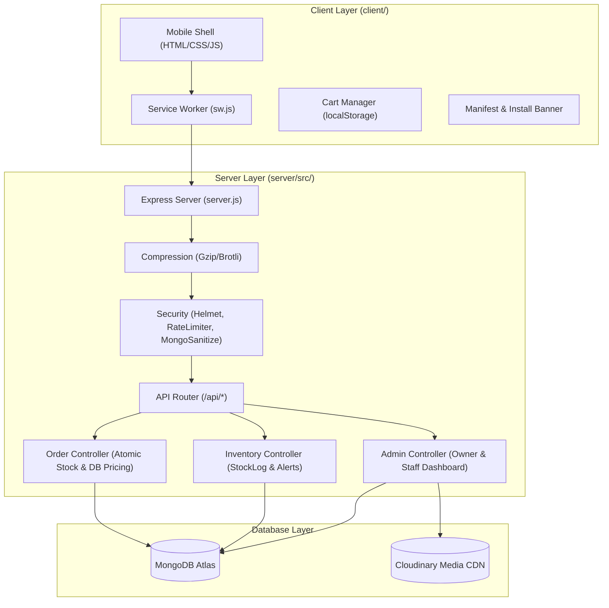

# Mahalaxmi Kirana Store — Architecture Documentation

## 1. System Overview

**Mahalaxmi Kirana Store** (`महालक्ष्मी किराणा स्टोअर्स`) is a lightweight, mobile-first e-commerce and inventory platform built specifically for rural retail conditions in Yesgaon, Kopargaon (Ahmednagar district, Maharashtra).

The system is optimized for low-to-mid-range Android smartphones accessing the web over constrained 3G/4G cellular networks, while providing a snappy, native-feeling app experience (Blinkit/Zepto tier) using standard web technologies without heavy JavaScript framework runtimes.

---

## 2. Architecture Diagram



---

## 3. Core Architectural Principles & Non-Negotiables

1. **Server-Side Price Authority:** Client payloads never dictate prices. `orderController.js` recalculates subtotals, delivery fees, and order totals strictly from database snapshots.
2. **Atomic Stock Decrements:** Stock deductions use MongoDB atomic queries:
   ```javascript
   Product.findOneAndUpdate({ _id, stockQuantity: { $gte: qty } }, { $inc: { stockQuantity: -qty } });
   ```
   Ensuring zero race conditions or overselling under concurrent checkouts.
3. **IST Standard Time Enforcement:** All delivery cutoffs (Morning 11:00 AM, Afternoon 4:00 PM, Evening 9:00 PM) and operational hours use `Asia/Kolkata` timestamps.
4. **Bilingual Presentation:** Marathi (`मराठी`) + English on all customer-facing touchpoints, button states, toasts, and status notices.
5. **Cart Persistence Rule:** HTTP 401 Unauthorized responses clear authentication tokens but never purge the customer's `kirana_cart` in `localStorage`.
6. **Zero Secrets in Git:** Sensitive configuration is loaded strictly via environment variables, with templates provided in `.env.example`.

---

## 4. Mobile & PWA Architecture

- **Viewport & Ergonomics:** Viewport configured with `viewport-fit=cover` and dynamic viewport units (`100dvh`). Tap targets are strictly $\ge 44 \times 44\text{px}$.
- **Bottom Navigation & Sheet Cart:** Fixed mobile bottom navigation with active indicators, live cart badges, floating cart bar, and a pull-down draggable bottom sheet cart.
- **Service Worker Lifecycle:**
  - Cache-first strategy for static core assets (CSS, JS, SVG, webmanifest).
  - Network-first strategy with cache fallback for read-only catalog endpoints.
  - Strict network-only bypass for authentication, mutations, and order submissions.
  - Branded offline fallback shell with direct telephone dial option.
- **Micro-interactions:** Guarded haptic vibration (`navigator.vibrate`) upon quantity adjustments and sheet triggers.

---

## 5. Directory Layout

```
MahalaxmiStore/
├── README.md                 # Setup, run, deployment, and testing guide
├── Dockerfile                # Production container specification
├── docker-compose.yml        # Orchestration configuration
├── docs/                     # Project audit, handover, PRD, and architecture
│   ├── ARCHITECTURE.md
│   ├── AUDIT.md
│   ├── PROJECT_HANDOVER.md
│   ├── MASTER_PRD_v2.0.pdf
│   └── assets/               # Product mockups, flow diagrams, and screenshots
├── client/                   # Customer storefront + Owner dashboard
│   ├── index.html            # Main storefront
│   ├── checkout.html         # 3-step checkout flow
│   ├── orders.html           # Customer order tracking & pull-to-refresh
│   ├── inbox.html            # Customer notification center
│   ├── login.html            # Phone/password authentication
│   ├── register.html         # Customer onboarding
│   ├── privacy.html          # Bilingual privacy & data policy
│   ├── sw.js                 # Service Worker (offline shell & catalog cache)
│   ├── manifest.webmanifest  # Bilingual PWA web manifest
│   ├── offline.html          # Branded offline fallback page
│   ├── css/                  # App styling, mobile-first design tokens
│   ├── js/                   # Vanilla client logic & state controllers
│   ├── images/               # Vectors, PWA app icons (192, 512)
│   └── admin/                # Owner management dashboard & packing lists
└── server/                   # Backend API server & database scripts
    ├── src/
    │   ├── server.js         # Entry point, Express pipeline, static serving
    │   ├── config/           # Database connection & Atlas client
    │   ├── controllers/      # Business logic handlers
    │   ├── models/           # Mongoose schemas (Product, Order, User, etc.)
    │   ├── routes/           # REST endpoint definitions
    │   ├── middleware/       # Auth, rate limiting, and sanitization
    │   ├── services/         # AI grocery parser & external services
    │   └── utils/            # Helper formatting & phonetics
    ├── scripts/              # Automated database backup & health pingers
    ├── seed/                 # Catalog seeding & owner initialization
    ├── tests/                # Automated verification suites
    ├── .env.example          # All configuration keys (placeholders only)
    └── package.json          # Server dependencies & test scripts
```
